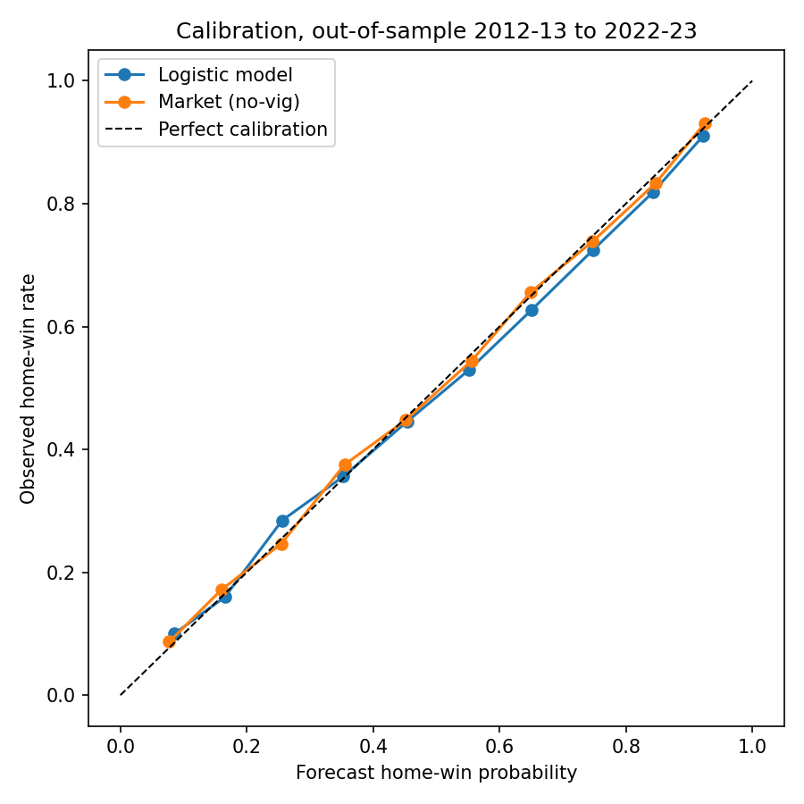
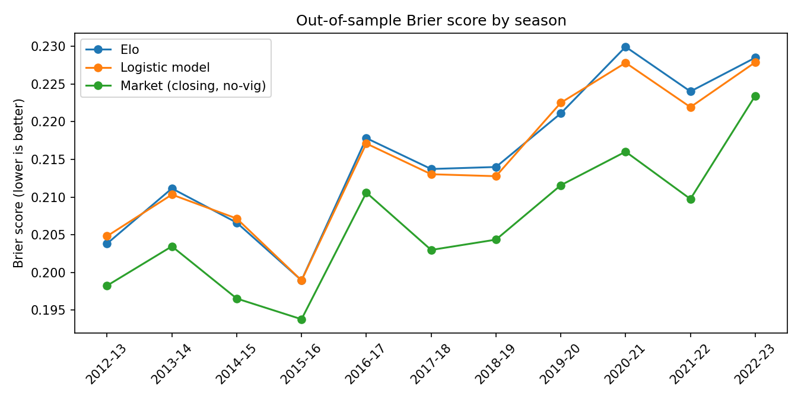
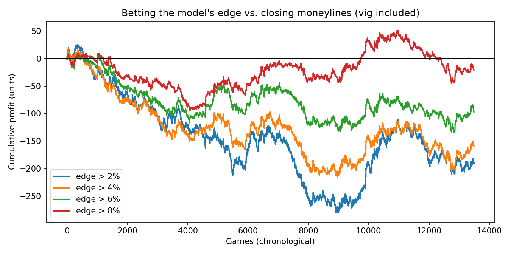

# NBA Win Probabilities vs. the Betting Market

Can a model built only from public game results forecast NBA games better
than the closing betting line, which works like a prediction-market price?
And is the model's disagreement with the *opening* line associated with
how that line later moves?

This is a historical research project. It builds pre-game win probabilities
for **19,822 NBA games (2007-08 to January 2023)** and evaluates them
strictly out of sample against no-vig probabilities implied by closing
moneylines. It is not a trading strategy, and nothing here shows a tradable
profit.

*Built with AI assistance. I reviewed and ran the code and can explain every
step. See `INTERVIEW_GUIDE.md`.*

## Results (out of sample, 2012-13 to 2022-23, 13,486 games)

| Forecast | Brier score | Log loss | Accuracy |
|---|---|---|---|
| Elo rating | 0.2146 | 0.6177 | 65.5% |
| Logistic model (Elo + form + rest) | 0.2141 | 0.6166 | 65.7% |
| **Closing market, vig removed** | **0.2055** | **0.5965** | **67.8%** |
| Market + model (stacked, out-of-fold) | 0.2056 | 0.5968 | 67.7% |

1. **The closing line has a lower Brier score than the model in every test
   season.** The model is reasonably calibrated, but the market is sharper.
2. **No additional information beyond the closing price was detected for
   this model and sample.** Forecast encompassing test (logit of the outcome
   on both log-odds, robust SEs): market coefficient 0.97 (SE 0.045), model
   coefficient -0.001 (SE 0.047, p = 0.98).
3. **Betting the model's edge did not make money after the vig.** Flat bets
   whenever model and market disagree by more than 2% to 8% returned between
   -2.0% and -0.5% per bet. Every bootstrap 95% interval includes zero.
4. **Historical association with line movement.** The model's disagreement
   with the opening spread is positively associated with the move from open
   to close: slope 0.071 (SE 0.008, p < 1e-17) on 13,481 games. When games
   with a back-to-back team are dropped, the slope is 0.042 (SE 0.010,
   p < 1e-4) on 9,228 games. Those games are dropped because their opening
   line may have been posted before the previous game ended.
   - This is an association, not proof that the model would have beaten the
     market in real time.
   - The archive has no timestamps for when opening lines were posted.
   - It has no opening moneylines, so no tradable return is estimated.





## Data and validation

**Odds and scores.** The [Sportsbook Reviews Online NBA odds archive](https://www.sportsbookreviewsonline.com/scoresoddsarchives/nba/nbaoddsarchives.htm)
provides:
- final scores
- opening and closing spreads
- closing moneylines, from 2007-08 to January 16, 2023

The archive states no data license, so the raw pages and the derived table
are **not committed**. `run_all.py` downloads and rebuilds them locally.

**Official dates and scores.** Every archive game is matched to the
[Basketball-Reference](https://www.basketball-reference.com/) season
schedule by season, teams and final score, and the schedule date is used.
- **All 19,822 games matched.**
- **12 dates were corrected**, for example Minnesota at the Lakers was
  played on 2020-12-27, but the archive lists 2020-12-28.
- **12 mistyped scores were corrected.** Same teams and date, but a
  different score, including one recorded as a 95-95 tie.
- The full audit is in `results/date_audit.json`. The pipeline stops if any
  team appears twice on the same date.

**Other cleaning.**
- Franchise moves are merged: Seattle becomes Oklahoma City, New Jersey
  becomes Brooklyn.
- The 2020 bubble, London and Mexico City games are flagged as neutral.
- Moneylines are converted to implied probabilities and normalized to sum to
  one. The average overround is 3.8%.
- 12 games with impossible lines are excluded from market comparisons.

## Method

**Features** (`src/features.py`) use only information from earlier games:
- Elo with home-court advantage, a margin-of-victory multiplier, and 25%
  reversion to the mean between seasons.
- Rolling 10-game point margin.
- Season-to-date win rate, shrunk toward .500.
- Rest days and back-to-back flags.

**Tuning.** Elo K and home advantage are chosen by log loss on 2008-09 to
2011-12 only: K = 20, HFA = 80. 2007-08 only warms up the ratings.

**Walk-forward evaluation** (`src/model.py`):
- Every season from 2009-10 on is predicted by a standardized logistic
  regression fit only on earlier seasons.
- The stacked market + model forecast for each test season is fit on those
  earlier **out-of-sample** predictions, never on in-sample fits.

**Evaluation** (`src/evaluate.py`):
- Brier score, log loss, accuracy and calibration.
- Forecast encompassing test.
- Flat-stake backtest at closing moneylines, with bootstrap CIs.
- Line-movement regression, including a rested-games robustness check.
  Spreads are mapped to probabilities with a normal margin model.
  Sigma = 11.6 points, estimated on the tuning seasons.

**Tests** (`tests/test_pipeline.py`, 11 tests):
- A game's own result and later results cannot change its pre-game
  features.
- Changing a future season's results cannot change earlier predictions.
- Moneyline, spread, payout and score arithmetic are correct.
- Double-booked teams are detected.
- Integrity checks run on the processed data.

## Limitations

- Closing lines include late injury and lineup news that this model never
  sees.
- There are no timestamps for opening lines and no opening moneylines. The
  line-movement result is a historical association only.
- Playoff and regular-season games are pooled. 2022-23 covers only
  October to mid-January.
- No player-level, travel or injury data yet. These are natural next steps.

## Reproduce

```bash
python -m pip install -r requirements.txt
python run_all.py                          # first run downloads ~170 pages (about 10 min)
python -m unittest discover -s tests -v
```
